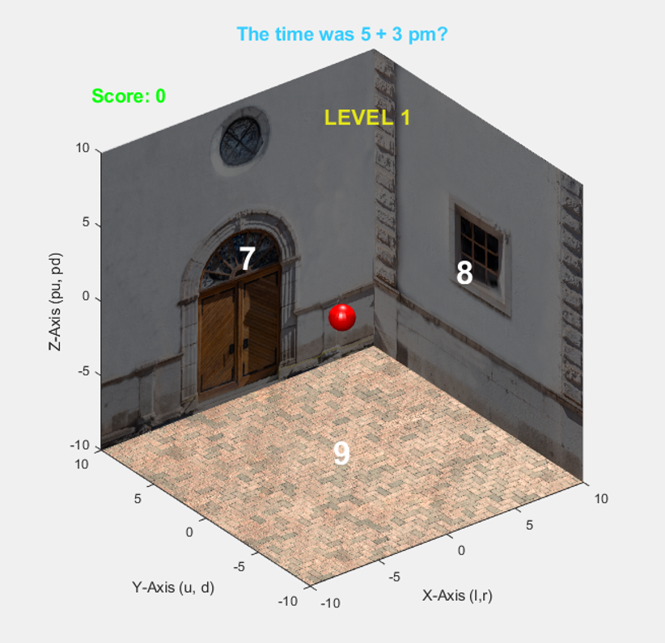

# 3D Math Quest (MATLAB)

A 3D educational math game built entirely in **MATLAB**. You control a red sphere rolling around the inside of a giant library cube. A math word problem appears at the top of the screen and three possible answers are displayed on the walls. **Roll into the correct wall** to score a point and move on to the next challenge!

  

## Requirements

- **MATLAB** (R2019b or newer recommended for the `audioplayer` object and texture mapping)
- No toolboxes required — uses base MATLAB graphics and audio.

## Required Assets

You must place the following files in the **same directory** as `ball_game.m`:

**Audio:**
- `adventure.wav` (background music)
- `correct.wav` (play when right answer)
- `incorrect.wav` (play when wrong answer)

**Images (Textures):**
*Set 1 (Questions 1–3):*
- `red_tile.png`
- `Library_door_1.png`
- `window.png`

*Set 2 (Questions 4–6):*
- `Library_floor.png`
- `Inner_door.png`
- `Inner_wall.png`

*Set 3 (Questions 7–9):*
- `Library_floor.png`
- `Library_books.png`
- `Library_window.png`

*(If you don't have these assets, you can temporarily replace the `imread()` calls with `ones(100, 100)` to generate solid-color placeholder walls.)*

## Usage

1. Open MATLAB.
2. Navigate to the folder containing `ball_game.m` and all assets.
3. Run the script:
   ```matlab
   ball_game
   ```
## Controls
| Key                  | Action                                                                  |
|----------------------|-------------------------------------------------------------------------|
| Left / Right Arrow   | Move along the X-axis (or Y-axis if touching the right wall)            |
| Up / Down Arrow      | Move along the Y-axis (or X-axis if touching the back wall)             |
| Page Up / Page Down  | Move along the Z-axis (or Y-axis if touching the bottom wall)           |
| R                    | Reset the ball to the center (0, 0, 0)                                  |
(Note: In MATLAB, the Z-axis points up by default, so "Page Up" moves the ball toward the screen/top).

## Known Issues
- The bgPlayer.TimerFcn is used to loop the background music. If the game closes abruptly, the audio might continue playing in the MATLAB workspace. Use stop(bgPlayer) to kill it.
- The text objects are placed at (0, 9, 0), (9, 0, 0), and (0, 0, -9). If you resize the window, the text might overlap with the walls. Use view(3) and manually rotate to see all answers clearly.